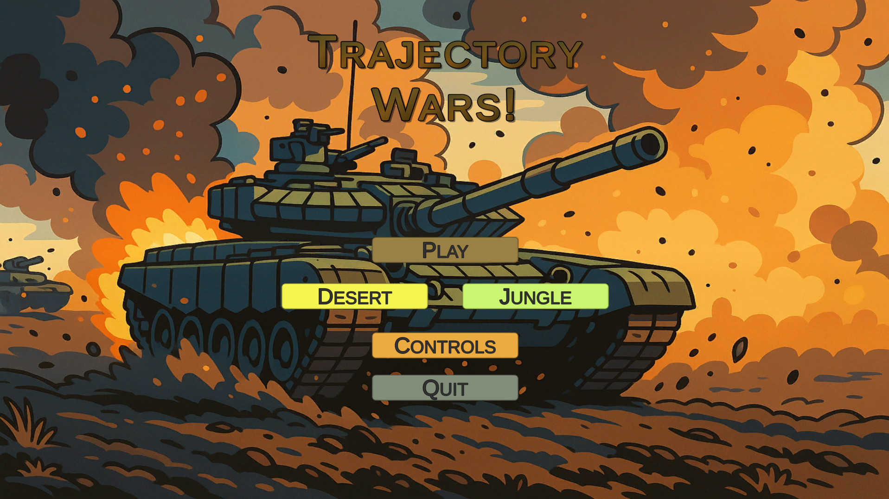
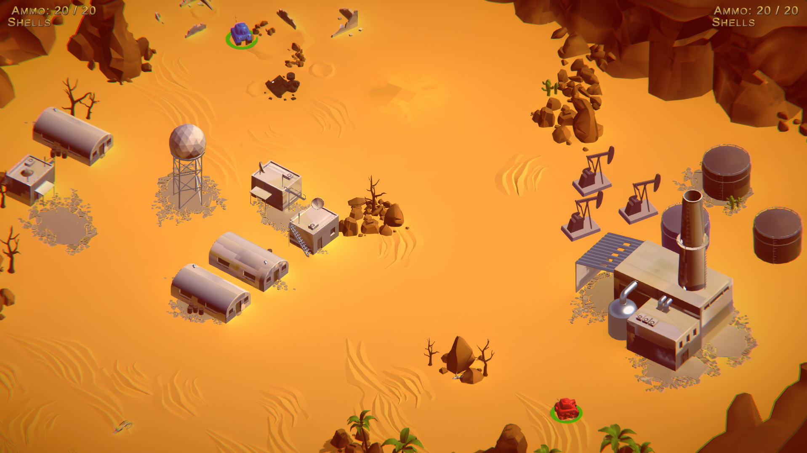
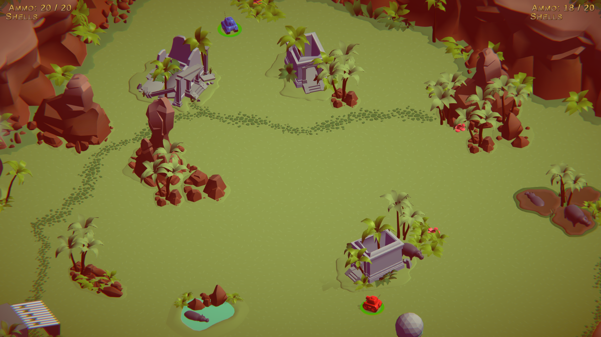
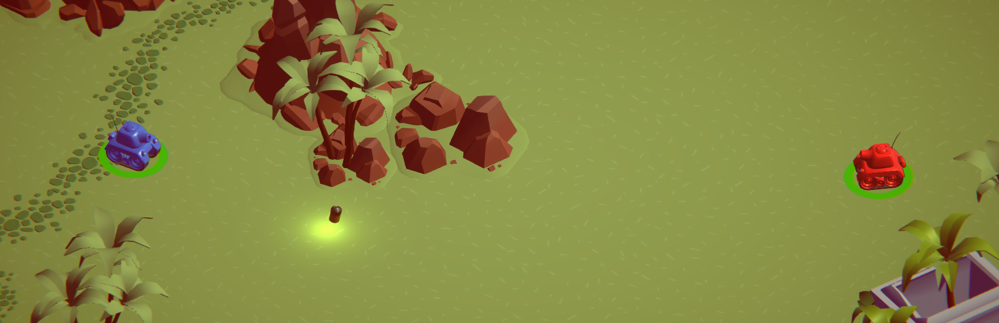

# Trajectory Wars

A local multiplayer tank battle game developed in Unity.

## About the Game

Trajectory Wars is a two-player local multiplayer tank combat game. It started as a Unity tank game project and was expanded with additional gameplay features, weapons, maps, menus, and controller support.

The objective is simple: battle against another player using different weapons and survive the fight.

## Screenshots

### Main Menu


### Desert Gameplay


### Jungle Gameplay


### Plasma Weapon


## Features

- **Local Multiplayer:** Two players can battle on the same computer.
- **Two Maps:** Choose between Desert and Jungle arenas.
- **Multiple Weapons:** Use standard shells or the additional Plasma weapon.
- **Separate Ammunition:** Each weapon has its own ammunition supply.
- **Reload System:** Reload weapons with individual reload mechanics.
- **Controller Support:** Play with a game controller.
- **Main Menu:** Start the game, select maps, view controls, or quit.
- **Pause Menu:** Pause gameplay, resume, or return to map selection.

## Weapons

### Standard Shell
The standard tank projectile used for regular combat.

### Plasma Shell
An additional weapon featuring a custom projectile, separate ammunition, and a dedicated firing system.

## Maps

- **Desert:** The original battlefield.
- **Jungle:** An additional playable arena.

## Controls

The game supports keyboard and controller input.

| Action | Player 1 | Player 2 |
|---|---|---|
| Switch standard weapon | 1 | Numpad 1 |
| Switch plasma weapon | 2 | Numpad 2 |
| Reload | R | Numpad 0 |
| Pause | Escape / Controller | Escape / Controller |

Movement and firing controls can be viewed through the in-game Controls menu.

## Technology

- Unity 6
- C#
- Universal Render Pipeline (URP)
- Unity Input Manager
- Git and GitHub

## Project Structure

```text
Trajectory-Wars/
├── Assets/
├── Packages/
├── ProjectSettings/
├── Screenshots/
│   ├── main-menu.png
│   ├── desert-gameplay.png
│   ├── jungle-gameplay.png
│   └── plasma-weapon.png
├── .gitignore
└── README.md
```

## Limitations

- Local multiplayer only.
- No online multiplayer.
- No AI-controlled opponents.
- Designed around two-player combat.

## Development

This project was developed as a hands-on game development project, involving gameplay programming, UI implementation, input handling, weapon mechanics, scene management, and audio integration.

## Future Improvements

- More maps and environments.
- Additional weapons.
- Improved visual effects.
- More gameplay options.
- Expanded multiplayer functionality.

---

**Developed with Unity.**